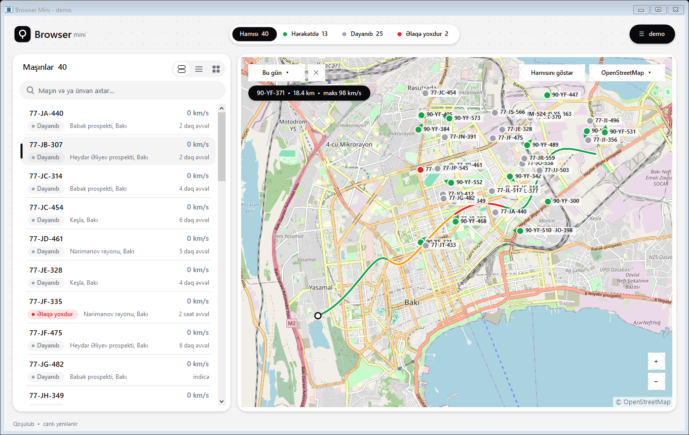
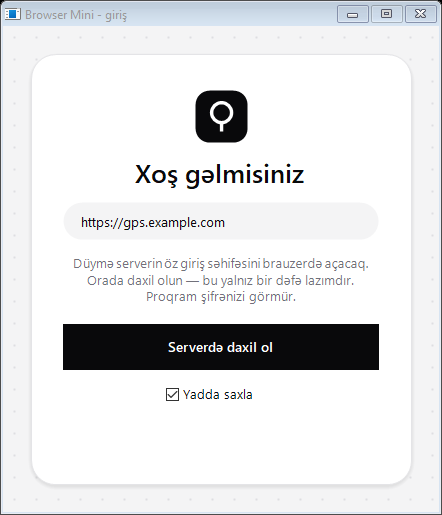
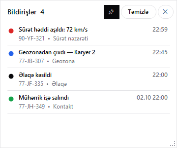

# Browser Mini — az RAM tutan brauzer əvəzi

Wialon əsaslı GPS monitorinq portalını brauzerdə açmaq əvəzinə istifadə olunan yüngül Windows proqramı.
Proqramda veb mühərriki yoxdur, Chromium, Edge və ya Firefox istifadə etmir. Birbaşa serverin API-si ilə işləyir,
ona görə adi brauzer tabının tutduğu yüzlərlə MB RAM əvəzinə **~30–45 MB** yaddaşla kifayətlənir.

> *English:* A lightweight Windows desktop client that replaces a heavy browser tab for Wialon-based GPS tracking portals.
> No web engine, talks to the Wialon Remote API directly, ~30–45 MB RAM. Single C# file, builds with the compiler built into Windows.



## Niyə?

| | RAM |
|---|---|
| Portal brauzerdə (Firefox, yüngül profil) | ~640 MB |
| **Browser Mini** | **~30–45 MB** |

## İmkanlar

- **Canlı monitorinq.** Maşınların siyahısı vəziyyət (hərəkətdə / dayanıb / əlaqə yoxdur), sürət, ünvan və son məlumat vaxtı ilə göstərilir. Məlumat hər 2 saniyədən bir yenilənir.
- **Siyahı görünüşləri.** Üç rejim var: kartlar, kompakt siyahı və şəbəkə. Axtarış və vəziyyət süzgəcləri də var.
- **Öz xəritəsi.** Maşınlar sürət istiqaməti ilə xəritədə göstərilir. Xəritəni sürüşdürmək, təkərlə yaxınlaşdırmaq və işarəyə klik edib maşını seçmək olar.
- **Xəritə növləri:**
  - serverin öz xəritəsi, OpenStreetMap, OpenTopoMap və Sentinel-2 peyk görüntüsü açarsız işləyir;
  - Esri, Mapbox və Google hibridləri öz pulsuz və ya rəsmi açarınızla işləyir.
- **Hərəkət tarixçəsi.** Maşına klik edəndə marşrut xəritədə çəkilir və xəttin rəngi sürətə görə dəyişir. Məsafə və maksimum sürət göstərilir. Müddət seçmək olar: 1 saat, 6 saat, bu gün, dünən və 7 günə qədər.
- **Üzən bildiriş pəncərəsi.** Yeri və ölçüsü dəyişdirilə bilir, həmişə üstdə qala bilir. Bildirişə klik edəndə xəritə hadisənin yerinə keçir.
- **Sakit bildiriş səsi.** Səs kompüter səsinin 5%-i ilə çalınır. Faizi `volume.txt` faylında dəyişmək olar.
- **Təhlükəsiz giriş.** Serverin öz giriş səhifəsində bir dəfə daxil olursunuz. Proqram şifrəni görmür, yalnız **oxumaq** icazəli token alır və onu Windows DPAPI ilə şifrələnmiş şəkildə saxlayır.
- Saat yanında ikon var, proqram kiçildiləndə ora gizlənir.

<p>
  
  
</p>

## Tələblər

- Windows 10 və ya 11. Proqram Windows-un içindəki .NET Framework 4.x-dən istifadə edir, əlavə heç nə quraşdırmaq lazım deyil.
- Wialon Remote API-yə çıxışı olan server. Proqram Wialon Local serverində sınanıb.

## Yığmaq və işə salmaq

```bat
build.bat
```

`build.bat` Windows-un daxili C# kompilyatoru (`csc.exe`) ilə `BrowserMini.exe` faylını yaradır. Sonra:

1. `BrowserMini.exe`-ni açın.
2. Server ünvanını yazın, məsələn `https://gps.example.com`.
3. **Serverdə daxil ol** düyməsini basın. Brauzerdə serverin öz giriş səhifəsi açılacaq, orada daxil olun.
4. **Yadda saxla** işarəlidirsə, növbəti dəfə avtomatik daxil olur.

## Ayar faylları

Bu fayllar proqramın qovluğunda yaranır və `.gitignore` ilə repozitoriyadan çıxarılıb:

| Fayl | Nə üçün |
|---|---|
| `server.txt` | server ünvanı (ilk girişdə avtomatik yazılır) |
| `volume.txt` | bildiriş səsi, kompüter səsinin faizi (default `5`) |
| `sound.wav` | öz bildiriş səsiniz (istəyə görə) |
| `mapbox_token.txt` | Mapbox hibridi üçün token |
| `esri_key.txt` | Esri hibridi üçün API açarı |
| `google_key.txt` | Google Hybrid üçün Map Tiles API açarı |
| `layer.txt`, `view.txt`, `alerts_window.txt` | son seçilən xəritə, siyahı görünüşü, bildiriş pəncərəsinin yeri |
| `browsermini.log` | diaqnostika jurnalı (açar və sessiya məlumatı yazılmır) |

## Xəritə mənbələri və şərtlər

| Mənbə | Açar | Qeyd |
|---|---|---|
| Serverin öz xəritəsi (Gurtam Maps) | — | Wialon sessiyası ilə |
| OpenStreetMap | — | [Tile usage policy](https://operations.osmfoundation.org/policies/tiles/) |
| OpenTopoMap | — | CC-BY-SA |
| Sentinel-2 cloudless 2016 (EOX) | — | CC BY 4.0, ~10 m detal |
| Esri World Imagery + yollar/adlar | pulsuz açar | [ArcGIS Location Platform](https://location.arcgis.com/), ayda 2 mln kafel pulsuz |
| Mapbox Satellite Streets | pulsuz token | [Mapbox](https://www.mapbox.com/pricing), ayda 200 000 kafel pulsuz |
| Google Hybrid | rəsmi API açarı | [Map Tiles API](https://developers.google.com/maps/documentation/tile) |

Proqram kafelləri yalnız rəsmi, açarlı API-lər vasitəsilə yükləyir. Google, Esri və Mapbox kafelləri onların şərtlərinə görə diskdə saxlanmır, xəritədə tələb olunan müəllif hüququ mətni göstərilir.

## Struktur

Bütün proqram bir fayldadır: [`BrowserMini.cs`](BrowserMini.cs). Faylda bu hissələr var: Wialon API müştərisi, giriş (OAuth token), xəritə komponenti (kafellər, marşrut, işarələr), dizayn komponentləri və proqramın səs sessiyasına nəzarət (Windows Core Audio).
